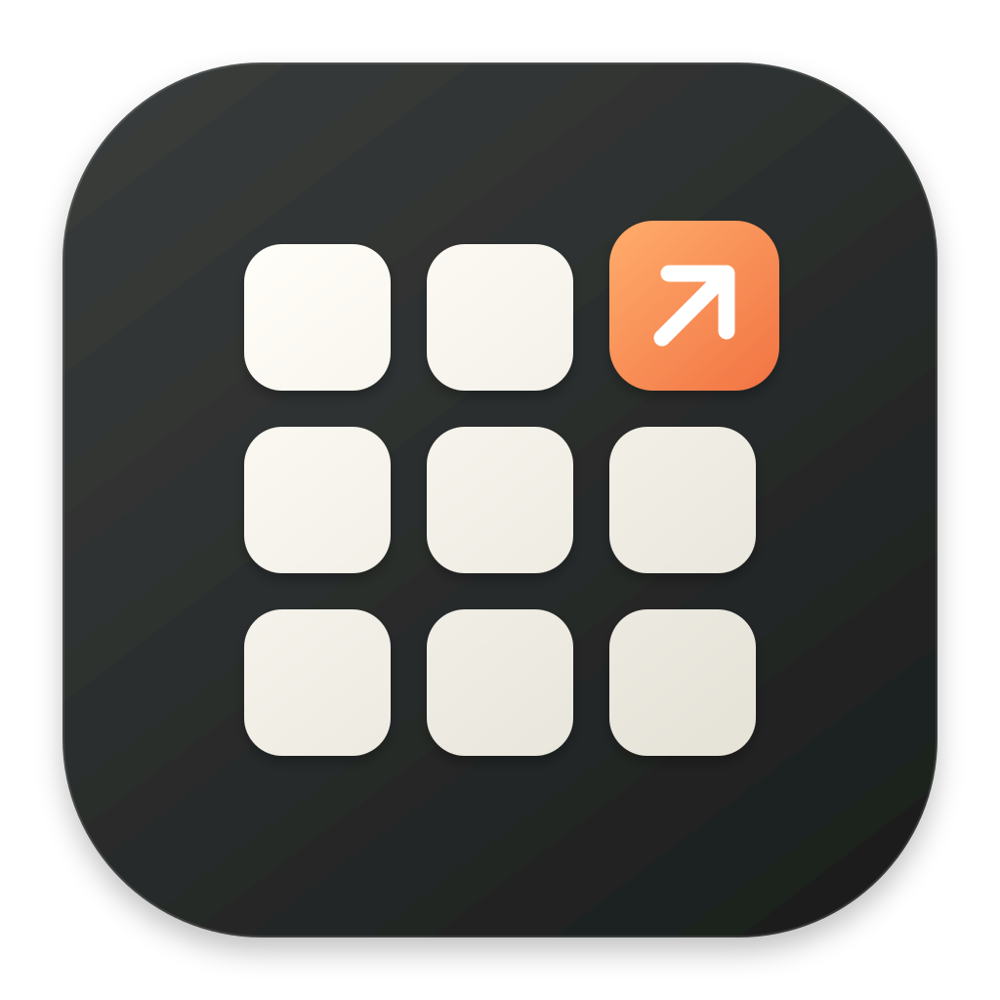

# gopad

English | [简体中文](README.zh-CN.md)



A macOS app launcher with a native glass interface, powered by Go and [MyGo](https://github.com/egoist/mygo). No Node.js runtime or frontend server required.

## Features

- Search and launch apps from an icon grid on your current desktop, with keyboard navigation and pagination. Search all visible apps by default, with the closest name matches first.
- Find Chinese app names with full pinyin or initials, such as `weixin` or `wx` for 微信.
- Organize apps with custom categories, favorites, drag-and-drop ordering, and hidden apps. Right-click an app on the launchpad to organize it or show it in Finder; drag icons to reorder them or add them to a section.
- Manage apps and preferences in a separate, resizable settings window.
- Adjust icon size and optionally remember your last category and each category’s page.
- Click empty space to close the launchpad. Settings let you change this behavior, search scope and ranking, page looping, Escape behavior, and Tab navigation.
- Customize the global shortcut and start automatically at login. Login launch stays hidden until you open the launchpad.
- Optionally show recent apps and display custom sections as folders on the launchpad. Folders share the same app memberships as their sections.
- Preview category suggestions from app metadata and add selected groups as editable sections without replacing your existing organization.
- Choose English, Simplified Chinese, or your system language; animations respect Reduce Motion.

## Quick start

Current target: **macOS 12+ on Apple Silicon**. Running from source requires Xcode Command Line Tools and the Go version specified in [go.mod](go.mod).

```sh
make run
```

Open the launcher from the Dock, menu bar, or global shortcut. Use the gear button or `⌘,` to open settings.

The global launch shortcuts below are defaults and can be changed in settings. Clicking empty space dismisses only the launchpad; application icons, the search field, section tabs, page controls, and settings controls remain interactive. The separate management window keeps its normal window behavior.

For app bundles and installation, `make build` / `make install` also require Python 3.9+ and a configured signing identity. Follow the [build, signing, and release guide (中文)](docs/build-release.md) for setup.

For GitHub CI signing, run `make signing-upload` to choose an existing signing identity or P12 and upload the required secrets interactively.

Releases use one ZIP for installation and signed automatic updates. When upgrading from v0.1.0, [install v0.1.1 manually once](docs/releases/0.1.1.md); later updates use ZIP automatically.

## Shortcuts

| Shortcut | Action |
| --- | --- |
| `⌃⌥Space` | Toggle launcher (release) |
| `⌃⌥⇧Space` | Toggle launcher (Dev / preview) |
| `⌘F` | Search apps |
| `⌘,` | Open settings |
| `Tab` / `⇧Tab` | Next / previous visible category, when enabled |
| `⌃Tab` / `⌃⇧Tab` | Next / previous visible category |
| Arrow keys / `Return` | Select / launch an app |
| `Page Up` / `Page Down`, `⌘←` / `⌘→` | Previous / next launcher page |
| `Esc` | Clear search first by default, then hide the launcher; in settings, close the current menu, dialog, or window |

## Development

Checks also require Python 3.9+ and Node.js 22 (for frontend tests):

```sh
npm ci --prefix tests/frontend
make check
```

UI translations live in [`internal/i18n/locales`](internal/i18n/locales).
