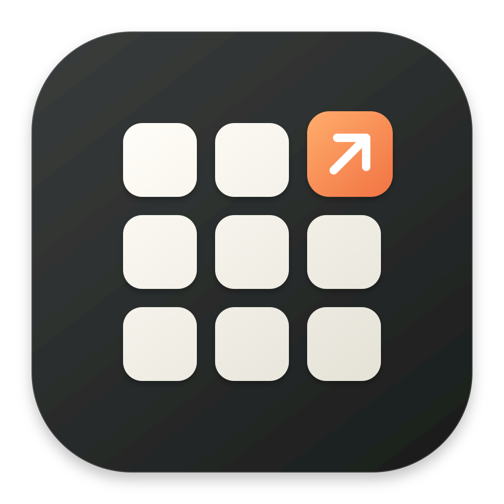

# gopad

[English](README.md) | 简体中文



为 macOS 制作的应用启动台，基于 Go 和 [MyGo](https://github.com/egoist/mygo)，采用原生玻璃界面。运行无需 Node.js 或独立前端服务。

## 功能

- 在当前桌面通过图标网格搜索、启动应用，支持键盘导航和分页。
- 中文应用名支持拼音全拼和首字母搜索，例如输入 `weixin` 或 `wx` 查找“微信”。
- 通过自定义分区、收藏、拖动排序和隐藏整理应用。
- 在独立、可调整大小的设置窗口中管理应用和偏好。
- 调整图标大小，重新打开时恢复上次使用的分区。
- 支持简体中文、英语和跟随系统，动画遵循系统“减少动态效果”设置。

## 快速开始

当前目标平台为 **macOS 12+、Apple Silicon**。从源码运行需要 Xcode Command Line Tools 和 [go.mod](go.mod) 指定的 Go 版本。

```sh
make run
```

点击 Dock、菜单栏图标或使用全局快捷键唤出启动台，通过齿轮按钮或 `⌘,` 打开设置。

构建应用包和安装时，`make build` / `make install` 还需要 Python 3.9+、Pillow 和已配置的签名身份，具体步骤见[构建、签名与发布指南](docs/build-release.md)。

配置 GitHub CI 签名时，运行 `make signing-upload`，按交互引导选择已有签名身份或 P12，并上传所需 Secrets。

发布版本使用同一个 ZIP 完成安装和签名自动更新。v0.1.0 用户需[手动安装一次 v0.1.1](docs/releases/0.1.1.md)，之后通过 ZIP 自动更新。

## 快捷键

| 快捷键 | 操作 |
| --- | --- |
| `⌃⌥Space` | 显示或隐藏启动台（正式版） |
| `⌃⌥⇧Space` | 显示或隐藏启动台（Dev / 预览版） |
| `⌘F` | 搜索应用 |
| `⌘,` | 打开设置 |
| `Tab` / `⇧Tab` | 在应用网格中切换下一个 / 上一个可见分区 |
| 方向键 / `Return` | 选择 / 启动应用 |
| `Page Up` / `Page Down` | 启动台上一页 / 下一页 |
| `Esc` | 收起启动台；设置窗口内关闭当前菜单、对话框或窗口 |

## 开发

完整检查还需要 Python 3.9+ 和 Node.js 22（用于前端测试），执行前先安装依赖：

```sh
npm ci --prefix tests/frontend
make check
```

界面翻译位于 [`internal/i18n/locales`](internal/i18n/locales)。
