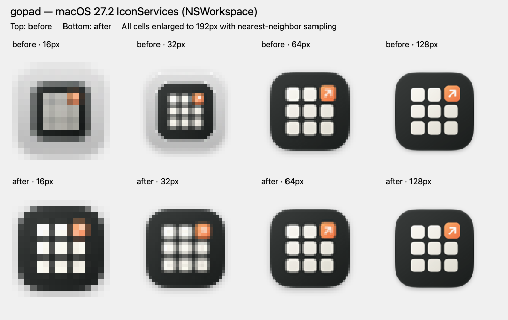

# Production macOS small-icon verification

On macOS 27.2 (26B123), IconServices put gopad's standard-resolution
16/32px artwork on a grey legacy plate. The production ICNS now omits
`ic04`/`ic05`, letting the system downsample its Retina PNGs. The generator
preserves the 16pt@2x and 32pt@2x representations and all larger artwork.
The source SVG, standalone PNG, and Dev icon generator are unchanged.

Columns: 16, 32, 64, 128 pixels. Top: baseline `6b4fc5b`. Bottom: this change.
Each icon was rendered at its stated pixel size through
`NSWorkspace.shared.icon(forFile:)` and enlarged to 192px with nearest-neighbor
sampling. The before/after fixtures used absolute paths, distinct random
bundle identifiers, and ad-hoc signatures. Their ICNS files matched the baseline
and modified production assets respectively. Comparison against a missing-path
placeholder rejected fallback icons. No fixture application was launched.

The 16/32px grey plates disappear; 64/128px retain the same overall shape.
This checks IconServices rendering on lara0, not the appearance of a running
application in Finder or the Dock.

Validation:

- The new regression failed against the original `ic04` resource and passes
  against the regenerated asset. It rejects `icp4`, `icp5`, `ic04`, and `ic05`,
  checks ICNS bounds, and requires the expected standard/Retina PNG dimensions.
- `make icon` succeeds. Every retained image chunk is byte-for-byte identical
  to the baseline; only `ic04`/`ic05` and iconutil metadata change.
- `make test-scripts`: 77 tests passed.
- `git diff --check` passes.
